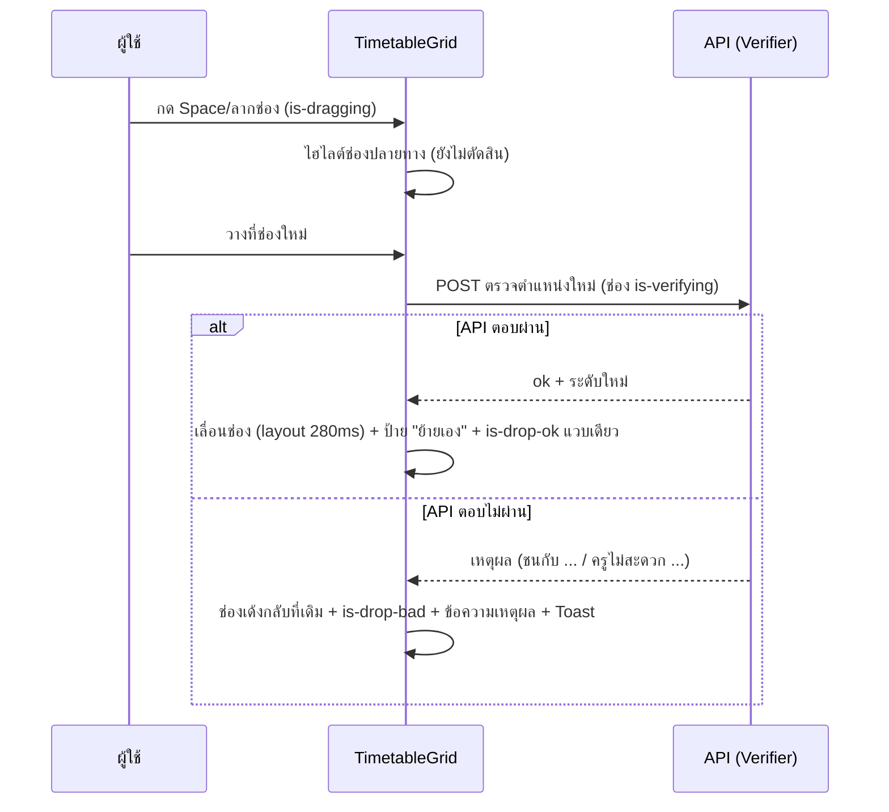
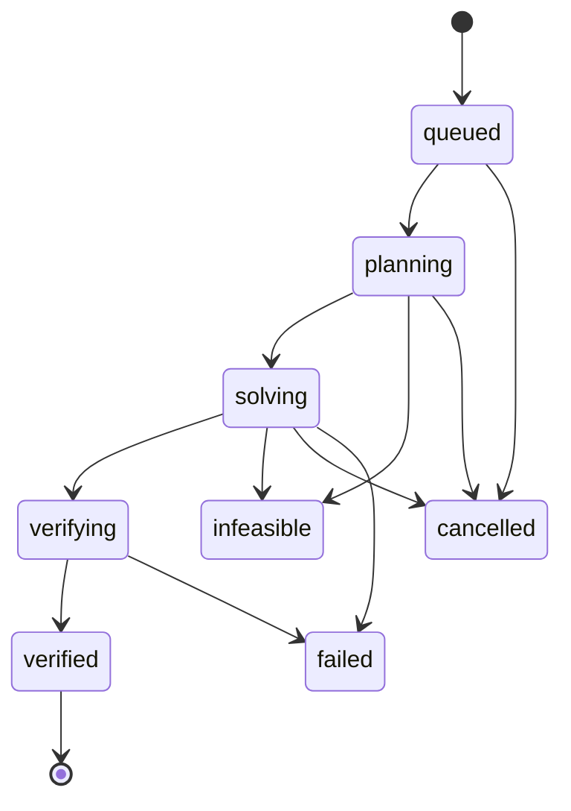

# Slotline Design System · กติกาสำหรับ AI โมเดลเล็ก

ไฟล์เดียวจบ: หน้าตา (design tokens), คอมโพเนนต์, ตารางเวลาแบบที่ต้องการ, การเคลื่อนไหว, เมทริกซ์ตัดสินใจ และกติกาที่ห้ามละเมิด
เขียนให้ AI โมเดลเล็กอ่านแล้วทำตามได้โดยไม่ต้องตีความ ไฟล์นี้ใช้คู่กับ `AI_RULES.md` (กติกาเรื่องข้อมูลและการจัดตาราง) ข้อ NEVER ของทั้งสองไฟล์มีผลพร้อมกัน
คำสำคัญ: **MUST** = ต้องทำ · **NEVER** = ห้ามทำเด็ดขาด · **STOP** = หยุดแล้วถามคน

## 0. สรุปหน้าตาใน 10 บรรทัด (อ่านข้อนี้ก่อน)

1. พื้นเขียวเข้ม กระจกฝ้าโปร่งแสงเป็นแผ่น มุมโค้งใหญ่ เมนูข้าง (Rail) เขียวเข้มทึบ
2. สีหลักเขียว `accent` สีเน้นรองเหลืองอำพัน `amber` ใช้เฉพาะจุดที่ต้องดึงสายตา
3. ฟอนต์ IBM Plex Sans Thai (ข้อความ) และ IBM Plex Mono (รหัสวิชา รหัสห้อง seed)
4. ระยะห่างมีแค่ 4 · 8 · 16 · 24 · 32 · 48px มุมโค้งมีแค่ 4 · 8 · 12 · 16 · 22px และแคปซูล
5. ปุ่มทรงแคปซูล hover แล้วยกและเรืองนุ่ม กดแล้วยุบเล็กน้อย
6. ตารางเวลา: ช่องวิชาเป็นการ์ดเล็ก มีรหัส ชื่อวิชา ห้อง ท-ป-น และชื่อครู ช่องมีป้ายระดับ (ผ่าน · ควรดู · ต้องแก้ · ยืนยันแล้ว · ย้ายเอง)
7. ลากช่องเพื่อย้ายได้ แต่ห้ามลากขอบเพื่อเปลี่ยนจำนวนคาบ และต้องให้ API ตรวจก่อนทุกครั้ง
8. ทุกสถานะมีคำ + ไอคอน + สี (ไม่ใช้สีอย่างเดียว)
9. การเคลื่อนไหวใช้เฉพาะ `transform` กับ `opacity` เวลาและ easing มาจาก token เท่านั้น
10. ทุกค่ามาจาก token และทุกคอมโพเนนต์ต้องใช้คลาส `sl-*` จากภาคผนวก B

## 1. วิธีใช้ไฟล์นี้

1.1 MUST อ่านทั้งไฟล์ก่อนเริ่มทุกงาน แล้วเปิดหัวข้อที่ตรงกับงาน (หัวข้อ 4 ถึง 7)
1.2 MUST ทำทีละหน้าจอ ทีละคอมโพเนนต์ ไม่เกิน 3 ไฟล์ต่อรอบ
1.3 MUST เริ่มจากคัดลอกโครง HTML และคลาสจากหัวข้อ 4 หรือ 5 แล้วแก้เฉพาะข้อความและข้อมูล
1.4 MUST วางภาคผนวก A (tokens.css) และ B (bundle.css) ไว้ที่ `apps/web/src/styles/` แล้ว import ทั้งสองไฟล์ ห้ามคัดลอกค่าไปเขียนซ้ำที่อื่น
1.5 ถ้าไม่แน่ใจ ให้ STOP ไม่ต้องเดา

## 2. ข้อห้ามเด็ดขาด (NEVER)

N1 NEVER ใส่สีเป็น hex, rgb(), hsl() ในไฟล์ใด ๆ นอก tokens.css ใช้ `var(--ชื่อ-token)` เท่านั้น
   ผิด: `color: #0F5132;` ถูก: `color: var(--accent);`
N2 NEVER สร้าง token ใหม่ สีใหม่ ขนาดตัวอักษรใหม่ หรือค่า spacing/radius/เงานอกรายการ ถ้าต้องการ ให้ STOP
N3 NEVER ใช้ระยะห่างนอก 4, 8, 16, 24, 32, 48px (`space-1` ถึง `space-6`) และมุมนอก `radius-*`
N4 NEVER ใช้ฟอนต์อื่นนอก IBM Plex Sans Thai (ข้อความ) และ IBM Plex Mono (รหัส) และ NEVER โหลดฟอนต์จากอินเทอร์เน็ตในระบบจริง ใช้ @fontsource
N5 NEVER สร้างคอมโพเนนต์ที่ไม่อยู่ในรายการ (Button, Card, Field, Toggle, Progress, StatusBadge, Toast, Dialog, EmptyState, DataTable, TimetableGrid, FlowDiagram, Rail) ถ้ารายการไม่พอ ให้ STOP
N6 NEVER สร้างสถานะที่ หัวข้อ 8.2 ระบุ "—" ถ้าต้องการ ให้ STOP
N7 NEVER ใช้สีอย่างเดียวบอกความหมาย ทุกสถานะ ทุกช่อง ทุกข้อผิดต้องมีคำ และไอคอนหรือรูปร่างประกอบ
N8 NEVER ถอดวงโฟกัส (`outline: none` ต้องมี `box-shadow: var(--focus-ring)` แทนทุกครั้ง) และต้องกดทุกอย่างด้วยคีย์บอร์ดได้
N9 NEVER ใช้ `backdrop-filter` เกิน 3 แผ่นต่อหน้าจอ และ NEVER ใช้ในช่อง TimetableGrid ช่องตาราง หรือรายการยาว (ใช้ `sl-card--flat`)
N10 NEVER ใส่การ์ดซ้อนการ์ดเกินหนึ่งชั้น NEVER ใส่แถบสีที่ขอบซ้ายของการ์ด NEVER ใช้ไล่สีม่วง-น้ำเงิน NEVER ใช้อีโมจิ
N11 NEVER ตัดข้อความไทยด้วย `…` (`text-overflow: ellipsis`) ในตารางเวลาและตาราง ให้ขึ้นบรรทัดใหม่ และ NEVER ตั้ง line-height ต่ำกว่า 1.5 (เนื้อหา) หรือ 1.3 (หัวเรื่อง)
N12 NEVER ใช้ตัวอักษรเล็กกว่า 12px (`caption`) และ NEVER ใช้ `ink-3` กับข้อความที่ต้องอ่านเพื่อทำงาน
N13 NEVER ปิดปุ่ม (`disabled`) โดยไม่มีข้อความบอกเหตุผลอยู่ใกล้ปุ่ม
N14 NEVER animate อย่างอื่นนอกจาก `transform` และ `opacity` (ข้อยกเว้นที่ หัวข้อ 7 ระบุ) NEVER เขียนเวลาหรือ easing เป็นตัวเลข ใช้ `var(--dur-*)` `var(--ease-*)`
N15 NEVER คิด preset การเคลื่อนไหวใหม่ ใช้เฉพาะรายการใน หัวข้อ 7
N16 NEVER ใส่ animation วนซ้ำในหน้าที่มีตาราง และ NEVER ใส่ animation ที่ไม่รองรับ `prefers-reduced-motion`
N17 NEVER ทำแถบ progress หรือตัวเลขให้วิ่งหลอก ค่าต้องมาจากเซิร์ฟเวอร์จริง ถ้ายังไม่ทราบค่าให้ใช้ `sl-spin` พร้อมข้อความ
N18 NEVER แสดงตัวเลขที่ไม่ได้มาจากระบบจริงโดยไม่ติดป้าย "ตัวอย่างข้อมูล"
N19 NEVER ทำให้หน้าเลื่อนแนวนอนที่ความกว้าง 390px ตารางกว้างต้องเลื่อนในกรอบ (`sl-tablewrap`)
N20 NEVER ให้พื้นที่กดเล็กกว่า 44px บนมือถือ
N21 NEVER ใช้ `transition: all` NEVER ใช้ `!important` (ยกเว้นบล็อก reduced-motion ใน bundle.css) NEVER เขียนสไตล์ซ้ำสิ่งที่ `bundle.css` มีแล้ว
N22 NEVER แก้ tokens.json, tokens.css หรือ bundle.css เพื่อให้งานผ่าน ถ้าต้องแก้ ให้ STOP
N23 NEVER พิมพ์ข้อความไทยในคอมโพเนนต์ ให้ใช้ `apps/web/src/i18n/th.ts`
N24 NEVER บอกว่า "เสร็จแล้ว" ก่อนรันคำสั่งตรวจในหัวข้อ 9 และแปะผลจริง

N25 NEVER ให้ลากขอบช่องเพื่อเปลี่ยนจำนวนคาบ จำนวนคาบต้องตรงกับ ท-ป-น ของรายวิชาเสมอ ช่องเลื่อนได้เฉพาะวันและคาบเริ่ม
N26 NEVER ตัดสินในหน้าเว็บว่าย้ายช่องได้หรือไม่ ทุกครั้งที่วางช่อง MUST เรียก API ตรวจ (ช่องขึ้น `is-verifying`) แล้วแสดงผลตามที่ API ตอบ
N27 NEVER แสดงระดับช่อง (ผ่าน · ควรดู · ต้องแก้) หรือเปอร์เซ็นต์ที่ไม่ได้มาจากผลตรวจของ Verifier ห้ามแต่งตัวเลข
N28 NEVER เปลี่ยนทิศของตารางในหน้า 4 ตารางหลักคือ **วันเป็นคอลัมน์ คาบเป็นแถว** ตามโจทย์ ส่วนแบบวันเป็นแถวเป็นตัวเลือกเสริมที่ผู้ใช้สลับได้ (ค่าตั้งต้นต้องเป็นแบบหลัก)

## 3. หน้าตาของระบบ (Layout และกรอบหน้า)

### 3.1 กรอบหน้า (ใช้ทุกหน้า)

```
┌──────────────┬─────────────────────────────────────────────────────────┐
│  Rail 250px  │  หัวเรื่องหน้า (h1)                    [ปุ่มหลัก 1 ปุ่ม] │
│  (side, ทึบ)  │  คำอธิบายหนึ่งบรรทัด (small, ink-2)                      │
│              │  ┌────────────────────── Card (glass) ─────────────────┐ │
│  ● นำเข้า     │  │  เนื้อหาของหน้า ห่างกัน space-4 (24px)              │ │
│  ○ คำขอพิเศษ  │  └─────────────────────────────────────────────────────┘ │
│  ○ จัดตาราง   │  ┌── Card ──────────────┐  ┌── Card ────────────────────┐│
│  ○ ดูตาราง    │  │                      │  │                            ││
│  ○ ผลการใช้ AI│  └──────────────────────┘  └────────────────────────────┘│
│  ○ สรุป·ส่งออก│                                                          │
└──────────────┴─────────────────────────────────────────────────────────┘
มือถือ (< 768px): Rail เป็นแถบบนเลื่อนแนวนอน · การ์ด 1 คอลัมน์ · ขอบข้าง 16px
```

### 3.2 หน้า 4 (ดูตาราง) แบบที่ต้องการ

```
┌─ Card: แถบข้อมูลกลุ่ม (sl-meta) ────────────────────────────────────────┐
│ รหัสกลุ่มเรียน   ชื่อกลุ่มเรียน   ภาคเรียน   สัปดาห์ที่มีผล   ครูที่ปรึกษา │
│ 693190102       สทท.4/2         1/2569     4–18 (15 สัปดาห์)  นางสายชล…  │
│ (label: caption/ink-3  ค่า: h3 600)           ลากการ์ดวิชาเพื่อย้ายวัน/คาบ │
└─────────────────────────────────────────────────────────────────────────┘
[ มุมมอง: กลุ่ม ▾ ] [ ค้นหา… ]  [ สลับทิศตาราง ]  [ ● ผ่าน ◐ ควรดู ✕ ต้องแก้ ✓ ยืนยันแล้ว ┄ ย้ายเอง ]
┌─ TimetableGrid ─────────────────────────────────────────────────────────┐
│          │ จันทร์ │ อังคาร │ พุธ │ พฤหัสบดี │ ศุกร์ │                     │
│ คาบ 1 08:30 │ ┌────┐ │        │     │          │ ┌────┐                  │
│ คาบ 2 09:30 │ │ท.… │ │        │     │          │ │ป.… │ ← ช่องผสาน rowspan │
│ คาบ 5 12:30 │ ═══ พักกลางวัน 12:30–13:30 ═══                              │
└─────────────────────────────────────────────────────────────────────────┘
รวม 14 คาบต่อสัปดาห์ (ในคำอธิบายตาราง)
```

ตัวเลือกเสริม (สลับทิศ): วันเป็นแถว คาบเป็นคอลัมน์ ตามภาพตัวอย่าง ใช้ `sl-tt sl-tt--rows` ห่อด้วย `sl-tablewrap` เลื่อนแนวนอนในกรอบ

### 3.3 เลย์เอาต์ตามความกว้าง

| ช่วงกว้าง | Rail | การ์ดต่อแถว | ขอบข้าง |
|---|---|---|---|
| ≥ 1200px | ข้าง 250px | 3–4 | `space-4` |
| 768–1199px | ข้าง 250px หรือแถบบน | 2 | `space-4` |
| < 768px | แถบบนเลื่อนแนวนอน | 1 | `space-3` · ปุ่ม ≥ 44px · ต้องไม่เลื่อนแนวนอนทั้งหน้าที่ 390px |

## 4. Design tokens

ค่าจริงอยู่ในภาคผนวก A เมื่อเขียนโค้ดให้ใช้ `var(--ชื่อ)` เท่านั้น

### 4.1 สี (สว่าง / มืด)

| token | สว่าง | มืด | ใช้ทำอะไร |
|---|---|---|---|
| `bg` | `#EAF2EC` | `#07140E` | ฉากหลังของหน้า (ใต้กระจกทุกแผ่น) ใช้ครั้งเดียวที่ body |
| `glass` | `#FFFFFF99` | `#122E2294` | แผงกระจกใหญ่ (Card, Rail, Dialog) ใช้ร่วมกับ blur ไม่เกิน 3 แผงต่อหน้าจอ |
| `glass-strong` | `#FFFFFFE0` | `#1A402FD9` | พื้นของส่วนควบคุมบนกระจก (Button รอง, Input, Toggle ปิด) และแถวตารางที่ต้องอ่านง่าย |
| `ink` | `#0E2419` | `#E3F0E8` | ตัวอักษรหลักบน bg, glass, glass-strong |
| `ink-2` | `#41574A` | `#A6BEB0` | ตัวอักษรรอง คำอธิบายสั้น บน bg, glass, glass-strong |
| `ink-3` | `#556B5D` | `#8FAB9B` | ป้ายกำกับเล็ก คำใบ้ บน bg และ glass-strong ห้ามใช้กับข้อความที่ต้องอ่านเพื่อทำงาน |
| `line` | `#0F513226` | `#96D7B429` | เส้นแบ่งบาง ๆ ในตารางและการ์ด (ตกแต่ง ไม่ใช่ขอบของปุ่ม) |
| `line-strong` | `#0F5132B3` | `#96D7B499` | ขอบของส่วนควบคุม (Input, Select, Toggle, Button รอง) ต้องเห็นชัด ≥ 3:1 |
| `accent` | `#0F5132` | `#7BD3A7` | สีหลักของแบรนด์ พื้นปุ่มหลัก ตัวเลขเน้น ไอคอนสำคัญ |
| `accent-2` | `#1E7A4E` | `#4FB784` | สีรองของเขียว ใช้กับเส้นข้อมูล ไอคอน ลิงก์ที่มีขีดเส้นใต้ และแถบ progress |
| `accent-soft` | `#1E7A4E1F` | `#7BD3A724` | พื้นอ่อนของ StatusBadge สำเร็จ และแถวที่เลือก |
| `on-accent` | `#F2FAF5` | `#05190F` | ตัวอักษรบนพื้น accent เท่านั้น |
| `amber` | `#F3C74A` | `#E8B23E` | สีเน้นรอง (ตามภาพอ้างอิงสีเหลือง) ใช้กับตัวชี้ที่ต้องดึงสายตา ช่องที่กำลังจัด จุดข้อมูลร้อน |
| `on-amber` | `#1B1405` | `#1B1405` | ตัวอักษรบนพื้น amber เท่านั้น |
| `amber-text` | `#7A4E0B` | `#E8B23E` | ตัวอักษรสีเหลืองอำพันบน bg และ glass (คำเตือน) ต้องมีป้ายคำกำกับด้วย |
| `amber-soft` | `#E8B23E33` | `#E8B23E2B` | พื้นอ่อนของ StatusBadge เตือน |
| `danger` | `#A8321F` | `#F59A8E` | ข้อผิดพลาด ความขัดแย้ง ชนกัน (ตัวอักษรและไอคอน) |
| `danger-soft` | `#B5382E1F` | `#F08A7E2B` | พื้นอ่อนของ StatusBadge ผิดพลาด และแถวที่ชน |
| `info` | `#1F5F8B` | `#8CC4EA` | ข้อมูลทั่วไปที่ไม่ใช่สำเร็จ/เตือน/ผิดพลาด (เฉพาะป้ายสถานะ "กำลังทำ") สีน้ำเงินต่างจากเขียวที่ความสว่าง |
| `info-soft` | `#1F5F8B1F` | `#8CC4EA26` | พื้นอ่อนของ StatusBadge กำลังทำ |
| `side` | `#0B3324` | `#051A11` | พื้นของ Rail (เมนูข้าง) เป็นเขียวเข้มทั้งสองธีม |
| `side-2` | `#12503A` | `#0C2D20` | ปลายไล่ระดับของ Rail |
| `side-ink` | `#E3F0E8` | `#E3F0E8` | ตัวอักษรบน Rail |
| `side-ink-2` | `#9CC2AE` | `#9CC2AE` | ตัวอักษรรองและไอคอนที่ยังไม่ active บน Rail |
| `side-hi` | `#FFFFFF1F` | `#FFFFFF1A` | พื้นตอน hover ของรายการบน Rail |
| `focus` | `#0B6B3F` | `#9BE3BE` | วงโฟกัสของทุกส่วนควบคุม ต้องเห็นชัดบนทุกพื้น (≥ 3:1) ห้ามถอด |
| `flow` | `{accent-2}` | `{accent-2}` | จุดข้อมูลที่วิ่งตามเส้นใน FlowDiagram |
| `code` | `#0F51320F` | `#7BD3A714` | พื้นของบล็อกโค้ดและรางของ progress |

### 4.2 ระยะห่าง (ใช้ได้เฉพาะ 6 ค่านี้)

| token | ค่า | ใช้ทำอะไร |
|---|---|---|
| `space-1` | `4px` | ช่องไฟเล็กสุด ระหว่างไอคอนกับข้อความ |
| `space-2` | `8px` | ระหว่างรายการใกล้กัน ระยะในป้าย |
| `space-3` | `16px` | ระยะในการ์ด ขอบข้างของหน้าบนมือถือ |
| `space-4` | `24px` | ระหว่างการ์ดในกริด |
| `space-5` | `32px` | ระหว่างส่วนใหญ่ |
| `space-6` | `48px` | ระยะหัวเรื่องหน้ากับเนื้อหา |

### 4.3 มุมโค้ง

| token | ค่า | ใช้ทำอะไร |
|---|---|---|
| `radius-sm` | `4px` | ป้ายเล็ก ช่องตาราง |
| `radius-md` | `8px` | Input, Select, แถวตาราง |
| `radius-lg` | `12px` | ปุ่ม การ์ดเล็ก |
| `radius-xl` | `16px` | การ์ด Dialog |
| `radius-2xl` | `22px` | แผงใหญ่และ Rail |
| `radius-pill` | `999px` | ปุ่มแบบแคปซูล ป้ายสถานะ Toggle |

### 4.4 ความหนาขอบ

| token | ค่า | ใช้ทำอะไร |
|---|---|---|
| `border-hair` | `0.5px` | เส้นแบ่งละเอียดในตาราง |
| `border-std` | `1px` | ขอบมาตรฐานของส่วนควบคุม |
| `border-bold` | `1.5px` | ขอบเน้น แถวที่เลือก วงโฟกัสด้านใน |

### 4.5 ขนาดไอคอน

| token | ค่า | ใช้ทำอะไร |
|---|---|---|
| `icon-sm` | `14px` | ไอคอนในป้ายและช่องตาราง |
| `icon-md` | `18px` | ไอคอนในปุ่มและเมนู |
| `icon-lg` | `22px` | ไอคอนนำหน้าการ์ดและ EmptyState |

### 4.6 เวลาและ easing ของการเคลื่อนไหว

| token | ค่า | ใช้ทำอะไร |
|---|---|---|
| `dur-fast` | `160ms` | hover และ press ของปุ่ม |
| `dur-med` | `280ms` | เข้าหน้า แผงเปิด Dialog |
| `dur-slow` | `420ms` | ตัวเลขนับขึ้น วงแหวน progress |
| `dur-flow` | `3200ms` | รอบของจุดข้อมูลใน FlowDiagram (เฉพาะหน้าอธิบายระบบ) |

| token | ค่า | ใช้ทำอะไร |
|---|---|---|
| `ease-out` | `cubic-bezier(.2,.7,.2,1)` | ค่าตั้งต้นของทุกการเคลื่อนไหว |
| `ease-in-out` | `cubic-bezier(.45,0,.2,1)` | การเปลี่ยนค่าไป-กลับ เช่น Toggle |

### 4.7 เงา

| token | ใช้ทำอะไร |
|---|---|
| `shadow-1` | ยกระดับ 1 (นุ่ม): การ์ดทั่วไป ช่องตาราง |
| `shadow-2` | ยกระดับ 2 (กลาง): แผงใหญ่ Rail ตอน hover ของการ์ด |
| `shadow-3` | ยกระดับ 3 (ลึก): Dialog และ Toast ที่ลอยเหนือหน้า |
| `glow` | เรืองนุ่มตอน hover และตอนกดปุ่มหลัก (สัมผัสแบบ tactile ตามภาพอ้างอิง) |
| `focus-ring` | วงโฟกัสสองชั้นใช้กับ :focus-visible ทุกจุด ห้ามถอด |

ค่าเงาแต่ละธีมอยู่ในภาคผนวก A เงาทุกชั้นมีทั้งเงาในและเงานอก (ตามภาพอ้างอิง ให้ความรู้สึกเป็นแผ่นนูน)

### 4.8 ตัวอักษร

ฟอนต์: `--font-sans` = IBM Plex Sans Thai · `--font-mono` = IBM Plex Mono ในระบบจริงโหลดจาก `@fontsource` ห้ามโหลดจากอินเทอร์เน็ต

| สไตล์ (คลาส) | ฟอนต์ | ขนาด / สูงบรรทัด | น้ำหนัก | ใช้ทำอะไร |
|---|---|---|---|---|
| `display` | sans | 40px / 54px | 600 | ชื่อหน้าใหญ่ใช้ได้หนึ่งครั้งต่อหน้า |
| `h1` | sans | 28px / 40px | 600 | หัวเรื่องหน้า (หน้า 1–6) |
| `h2` | sans | 22px / 32px | 600 | หัวเรื่องส่วน |
| `h3` | sans | 18px / 28px | 600 | หัวการ์ด |
| `body` | sans | 15px / 24px | 400 | เนื้อหาทั่วไป |
| `body-strong` | sans | 15px / 24px | 600 | เน้นในประโยค |
| `small` | sans | 13.5px / 22px | 400 | คำอธิบายใต้หัว ข้อความในช่องตาราง |
| `caption` | sans | 12px / 18px | 500 | ป้ายกำกับ ขั้นต่ำของระบบนี้ ห้ามเล็กกว่านี้ |
| `mono` | mono | 13px / 20px | 400 | รหัสวิชา รหัสห้อง seed |
| `figure` | mono | 44px / 52px | 500 | ตัวเลขใหญ่ในการ์ดสรุป (ตามภาพอ้างอิง) ใช้ tabular-nums |

บรรทัดสูง ≥ 1.5 (เนื้อหา) และ ≥ 1.3 (หัวเรื่อง) เพราะสระและวรรณยุกต์ไทยซ้อนสูง ตัวเลขในตารางใช้ `sl-num` (tabular-nums)

### 4.9 น้ำเสียงข้อความ (Content)

- ภาษาไทยสุภาพ กระชับ ไม่ใช้อีโมจิ ไม่ใช้เครื่องหมายอัศเจรีย์ ปีเป็น พ.ศ. เวลา 24 ชั่วโมง (08:30)
- ปุ่มเป็นคำกริยา: "จัดตาราง" · "ยืนยันใช้ข้อมูลนี้" · "ดาวน์โหลด Excel" · "ยกเลิก"
- ผลลัพธ์บอกตัวเลขจริง: "จัดครบ 612 จาก 612 รายการ" · "ชน 0 จุด"
- ข้อผิดพลาดบอก 3 อย่างเสมอ (ที่ไหน · ผิดอะไร · แก้อย่างไร): "แผ่นงาน ครู แถว 7: รหัส TIT02 ซ้ำกับแถว 3 ให้เปลี่ยนรหัสแถว 7"
- ตัวเลขที่ไม่ได้มาจากระบบจริงต้องมีป้าย "ตัวอย่างข้อมูล"

## 5. คอมโพเนนต์ (ห้ามมีนอกรายการนี้)

รายการ: Button · Card · Field · Toggle · Progress · StatusBadge · Toast · Dialog · EmptyState · DataTable · TimetableGrid · FlowDiagram · Rail · SplitCompare · MetaStrip

### 5.1 Button

```html
<button class="sl-btn sl-btn--pri">จัดตาราง</button>
<button class="sl-btn">ยกเลิก</button>
<button class="sl-btn sl-btn--pri is-loading" aria-busy="true"><span class="sl-spin"></span>กำลังจัด</button>
<button class="sl-btn" disabled>ส่งออก</button><p class="sl-hint">ต้องผ่านการตรวจก่อนส่งออก</p>
```

ตัวเลือก: `--pri` · `--ghost` · `--danger` · `--sm` · สถานะ: ปกติ, hover, pressed, disabled, loading · ปุ่มหลักได้ 1 ปุ่มต่อกลุ่มการทำงาน · ห้ามปิดปุ่มโดยไม่มีข้อความเหตุผลใกล้ปุ่ม

### 5.2 Card (แผงกระจก)

```html
<section class="sl-card sl-card--raised">
  <div class="sl-card__head"><h3 class="sl-card__title">ผลตรวจของระบบ</h3><span class="sl-badge sl-badge--ok">…</span></div>
  <div class="figure sl-num">612</div><p class="sl-hint">จัดครบจาก 612 รายการ</p>
</section>
```

ตัวเลือก: `--raised` · `--flat` (ไม่ blur ใช้ในรายการยาว) · `--sm` · `--hover` (เฉพาะที่กดได้) · blur ไม่เกิน 3 แผ่นต่อหน้าจอ

### 5.3 Field

```html
<div class="sl-field is-error">
  <label class="sl-label" for="code">รหัสครู</label>
  <input id="code" class="sl-input is-error" aria-invalid="true" aria-describedby="code-e">
  <div class="sl-error" id="code-e"><svg …/><span>รหัส TIT02 ซ้ำกับแถว 3 ให้เปลี่ยนรหัสแถว 7</span></div>
</div>
```

`<label for>` ทุกช่อง · ช่องสูง ≥ 44px · ข้อผิดพลาดมีไอคอนและวิธีแก้ · ค่า seed ใช้ `sl-mono`

### 5.4 Toggle

```html
<label class="sl-toggle"><input type="checkbox" checked><span class="sl-toggle__track"></span>ใช้ AI อ่านคำขอ</label>
```

### 5.5 Progress (แถบ และวงแหวนสีเหลืองตามภาพอ้างอิง)

```html
<div class="sl-meter" role="progressbar" aria-valuemin="0" aria-valuemax="100" aria-valuenow="72"><i style="--v:72%"></i></div>
<div class="sl-ring" role="img" aria-label="ครบ 75 เปอร์เซ็นต์"><svg viewBox="0 0 120 120"><circle class="trk" cx="60" cy="60" r="54"/><circle class="val" cx="60" cy="60" r="54" style="--p:.75"/></svg><div class="sl-ring__c"><b class="figure sl-num">75%</b></div></div>
```

ค่าต้องมาจากเซิร์ฟเวอร์ (SSE) ห้ามวิ่งหลอก ถ้าไม่ทราบค่าให้ใช้ `<span class="sl-spin">` พร้อมข้อความ

### 5.6 StatusBadge

```html
<span class="sl-badge sl-badge--ok"><svg …check/>verified</span>
<span class="sl-badge sl-badge--warn"><svg …alert/>ควรดู</span>
<span class="sl-badge sl-badge--bad"><svg …x/>ต้องแก้</span>
```

ตัวเลือก: `--ok` · `--info` · `--warn` · `--bad` · `--mute` · ต้องมีคำและไอคอนเสมอ

### 5.7 Toast และ Dialog

```html
<div class="sl-toast sl-toast--ok sl-toast--in" role="status"><svg …/><div><b>นำเข้าสำเร็จ</b><div class="sl-help">กดยืนยันเพื่อใช้ข้อมูล</div></div></div>

<div class="sl-scrim"><div class="sl-dialog sl-dialog--in" role="dialog" aria-modal="true" aria-labelledby="dt">
  <h3 class="sl-card__title" id="dt">ยืนยันใช้ข้อมูลนี้?</h3>
  <div class="sl-dialog__act"><button class="sl-btn">ยกเลิก</button><button class="sl-btn sl-btn--pri">ยืนยันใช้ข้อมูลนี้</button></div>
</div></div>
```

Toast ไม่ใช้กับรายงานข้อผิดยาว (ใช้ DataTable) · Dialog ต้องจับโฟกัส กด Esc ปิดได้ คืนโฟกัสให้ปุ่มที่เปิด ห้ามซ้อน Dialog

### 5.8 EmptyState

```html
<div class="sl-empty"><div class="sl-empty__ic"><svg …file/></div><h3 class="sl-card__title">ยังไม่มีข้อมูล</h3>
<p class="sl-help">อัปโหลดไฟล์ Excel หรือดาวน์โหลดตัวอย่างเพื่อเริ่มต้น</p><button class="sl-btn sl-btn--pri">อัปโหลด Excel</button></div>
```

### 5.9 DataTable (รวมเมทริกซ์ตัวเลข)

```html
<div class="sl-tablewrap"><table class="sl-table">
  <thead><tr><th scope="col">แผ่นงาน</th><th scope="col" class="num">แถว</th><th scope="col">สิ่งที่ผิด</th><th scope="col">วิธีแก้</th></tr></thead>
  <tbody><tr class="is-selected"><th scope="row">ครู</th><td class="num">7</td><td>รหัส TIT02 ซ้ำกับแถว 3</td><td>เปลี่ยนรหัสแถว 7</td></tr></tbody>
</table></div>
```

สถานะแถว: hover (อัตโนมัติ) · `is-selected` · `is-conflict` (ต้องมี StatusBadge ในแถวด้วย) · ห้ามตัดข้อความด้วย … · เลื่อนในกรอบ ไม่ให้หน้าเลื่อน

### 5.10 SplitCompare ("ต้นฉบับ | สิ่งที่ระบบเข้าใจ") และ MetaStrip

ใช้ในหน้า 2 (คำขอพิเศษ: ข้อความไทยคู่กับเงื่อนไขที่ระบบอ่านได้) และหน้า 1 (ตัวอย่างแถวที่อ่านจากไฟล์) ซ้าย = ต้นฉบับ ขวา = ผลที่ระบบเข้าใจ พร้อมป้ายระดับ

```html
<div class="sl-split">
  <div class="sl-split__pane"><span class="sl-label">ต้นฉบับ</span><p>ครูจิราพร ถ้าเลี่ยงได้ไม่สอนคาบแรก</p></div>
  <div class="sl-split__pane"><span class="sl-label">ระบบเข้าใจว่า</span>
    <p class="sl-mono">ครู TIT02 · ไม่สอนคาบ 1</p><span class="sl-badge sl-badge--warn">…ทำถ้าทำได้</span>
    <div class="row"><button class="sl-btn sl-btn--sm">แก้</button><button class="sl-btn sl-btn--sm sl-btn--pri">ยืนยัน</button></div></div>
</div>

<dl class="sl-meta"><div><dt>รหัสกลุ่มเรียน</dt><dd class="sl-mono">693190102</dd></div><div><dt>ชื่อกลุ่มเรียน</dt><dd>สทท.4/2</dd></div>…</dl>
```

## 6. TimetableGrid แบบที่ต้องการ (ตามภาพตัวอย่าง)

ภาพตัวอย่างมีองค์ประกอบ 5 อย่างที่ต้องเอามาใช้ และ 3 อย่างที่ **ห้าม** เอามา

| จากภาพตัวอย่าง | ทำอย่างไรในระบบนี้ |
|---|---|
| แถบข้อมูลกลุ่มด้านบน (รหัสกลุ่ม · ชื่อกลุ่ม · ภาคเรียน · สัปดาห์ที่มีผล · ครูที่ปรึกษา) | ใช้ `sl-meta` ข้อมูลมาจาก API |
| ช่องเป็นการ์ดเล็ก: รหัสตัวหนา · ชื่อวิชา · ห้อง + ท-ป-น · ชื่อครูขีดเส้นประ | ใช้โครงช่องในหัวข้อ 6.1 ชื่อครูกดแล้วไปมุมมองครู |
| หัวคาบมีเวลาและเลขคาบ (08:00 / 1) | `th` แสดงเลขคาบกับเวลาเริ่ม (24 ชม.) |
| ระดับของช่อง 5 แบบ + คำอธิบายสี (legend) | ใช้ป้าย `sl-badge` ในช่อง และ legend ด้านบนตาราง (6.2) |
| ลากการ์ดเพื่อย้ายวัน/คาบ | ใช้ dnd-kit + ตรวจกับ API ก่อนยืนยัน (6.3) |
| **ห้าม** ตัดข้อความด้วย … (ในภาพรหัสวิชาถูกตัด) | ให้ขึ้นบรรทัดใหม่ แสดงรหัสและชื่อเต็มเสมอ (N11) |
| **ห้าม** ลากขอบขวาเพื่อขยายเวลา | จำนวนคาบต้องตรง ท-ป-น (N25) ไม่มีที่จับขอบ |
| **ห้าม** ใช้เปอร์เซ็นต์ความมั่นใจที่แต่งเอง | ระดับช่องมาจาก Verifier เท่านั้น (N27) |

### 6.1 โครงของช่อง

```
┌──────────────────────────────┐
│ [ป้ายระดับ: ควรดู]            │  ← sl-badge (แสดงเมื่อระดับไม่ใช่ "ผ่าน")
│ ท.31901-2007                 │  ← sl-cell__code (ท. = ทฤษฎี, ป. = ปฏิบัติ)
│ เทคโนโลยีการจัดการฐานข้อมูล    │  ← ชื่อวิชา ขึ้นบรรทัดใหม่ได้ ไม่ตัด
│ COM602 · ท1 ป4 น3             │  ← ห้อง + sl-cell__tnn (ท-ป-น)
│ ไมตรี┄┄┄┄                     │  ← sl-cell__teacher (เส้นประ กดได้)
└──────────────────────────────┘
```

```html
<td rowspan="4"><div class="sl-cell sl-cell--practice sl-cell--review is-draggable" tabindex="0" data-session="S0007-p">
  <span class="sl-badge sl-badge--warn"><svg …alert/>ควรดู</span>
  <span class="sl-cell__code">ป.31901-2007</span>
  <small>เทคโนโลยีการจัดการฐานข้อมูล</small>
  <small>COM-02 · <span class="sl-cell__tnn">ท1 ป4 น3</span></small>
  <button class="sl-cell__teacher" type="button">ไมตรี</button>
</div></td>
```

กติกาช่อง: วิชาต่อเนื่องหลายคาบเป็นช่องเดียว (`rowspan` หรือ `colspan`) · แถวพักกลางวันเห็นชัด · ช่องที่ซ้อนกันแสดงทั้งสองวิชาในช่องเดียวและเป็น `--fix` · ช่องว่างใช้ `sl-cell--free` และมี `aria-label="ว่าง"` · ช่องกดได้ด้วยคีย์บอร์ด (`tabindex="0"`) · เปิดแผงรายละเอียดบอกว่าผ่านกฎข้อไหนบ้าง

### 6.2 ระดับของช่อง (ต้องมาจาก Verifier)

| ระดับ | คลาส | ป้าย (คำ + ไอคอน) | ความหมาย | แหล่งข้อมูล |
|---|---|---|---|---|
| ผ่าน | (ค่าตั้งต้น) | ไม่ต้องมีป้าย (legend บอกว่าช่องปกติ = ผ่าน) | ไม่มีโทษ | `penalty = 0` ของช่อง |
| ควรดู | `sl-cell--review` | `--warn` + alert "ควรดู" | ผิดกฎ soft (มีคะแนนโทษ) | `penalty > 0` และ hard = 0 |
| ต้องแก้ | `sl-cell--fix` | `--bad` + x "ต้องแก้" | ผิดกฎ hard หรือชน (เห็นเฉพาะ admin ที่ยังไม่ verified) | `hard > 0` |
| ยืนยันแล้ว | `sl-cell--confirmed` | `--ok` + check "ยืนยันแล้ว" | admin กดยืนยันช่องนี้ | ผู้ใช้กดยืนยัน (บันทึกใน audit) |
| ย้ายเอง | `sl-cell--moved` | `--mute` "ย้ายเอง" | ผู้ใช้ลากย้ายจากที่ solver จัดไว้ | มีรายการย้ายใน run นี้ |

ช่องหนึ่งมีได้หลายระดับพร้อมกัน (เช่น ย้ายเอง + ยืนยันแล้ว) ให้แสดงป้ายทุกอัน legend อยู่เหนือตาราง ประกอบด้วยตัวอย่างช่องเล็กและคำของทั้ง 5 ระดับ

### 6.3 การลากย้ายช่อง (ลำดับที่ต้องทำตาม)



- เมาส์/สัมผัส: ลากด้วย dnd-kit · คีย์บอร์ด: Space หยิบ · ลูกศรเลื่อน · Space วาง · Esc ยกเลิก · ประกาศผลทุกขั้นใน `aria-live="polite"` ("หยิบ S0007 ปฏิบัติ", "วางที่ วันพุธ คาบ 3", "ย้ายไม่ได้: ครูไม่สะดวก")
- ระหว่างลาก: `is-dragging` (ยก `shadow-3` scale 1.02) · ช่องปลายทางที่ API เคยตอบแล้วแสดง `is-drop-ok` หรือ `is-drop-bad` ถ้ายังไม่ทราบ ไม่ใส่คลาสทั้งสอง
- ถ้าตารางมีช่อง > 200 ช่อง ห้ามใช้ layout animation (ใช้ fade 160ms แทน)

### 6.4 สถานะของช่อง (เมทริกซ์)

| สถานะ | คลาส/วิธี | มี | หมายเหตุ |
|---|---|---|---|
| ปกติ | `sl-cell` + ประเภท (`--theory`, `--practice`) | ใช่ | |
| hover | `:hover` / `is-hover` | ใช่ | ยก 1px + `shadow-1` |
| focus | `:focus-visible` | ใช่ | วงโฟกัส `focus-ring` |
| กำลังลาก | `is-dragging` | ใช่ | |
| วางได้ / วางไม่ได้ | `is-drop-ok` / `is-drop-bad` | ใช่ | ต้องมีข้อความเหตุผลเมื่อวางไม่ได้ |
| กำลังตรวจ | `is-verifying` | ใช่ | โปร่ง 70% ไม่รับการกด + `sl-spin` |
| ควรดู · ต้องแก้ · ยืนยันแล้ว · ย้ายเอง | ตาราง 6.2 | ใช่ | มีป้ายทุกครั้ง |
| ที่เลือกอยู่ (กำลังจัด) | `sl-cell--hot` | ใช่ | |
| ว่าง · พักกลางวัน | `--free` · `--break` | ใช่ | |
| กำลังขยายเวลา (resize) | — | **ไม่มี** | ห้ามสร้าง (N25) |

## 7. การเคลื่อนไหว (Motion)

การเคลื่อนไหวมีสามหน้าที่เท่านั้น: ตอบสนองการกด · บอกว่ามีของใหม่เข้ามา · แสดงความคืบหน้าหรือเส้นทางข้อมูล ดูเวลาและ easing ในหัวข้อ 4.6

### 7.1 Preset ที่ใช้ได้ (มีเท่านี้)

| preset (คลาส) | ทำอะไร | เวลา | ข้อจำกัด |
|---|---|---|---|
| `sl-enter` | เข้าหน้า: opacity 0→1 + ขึ้นจาก 12px | `dur-med` 280ms | ต่อหน้าจอหนึ่งครั้งตอนโหลด |
| `sl-stagger` + `--i` | รายการเข้าทีละใบห่าง 40ms | `dur-med` | ไม่เกิน 8 รายการ |
| `sl-card--hover` | ยก 2px + `shadow-2` + `glow` | `dur-fast` 160ms | เฉพาะการ์ดที่กดได้ |
| `sl-btn` hover/active | ยก 1px / กดยุบ scale .985 | `dur-fast` | มีอยู่แล้ว ห้ามเขียนซ้ำ |
| `sl-toggle` | ปุ่มกลมเลื่อน translateX 16px | `dur-fast` ease-in-out | |
| `sl-toast--in` | Toast เข้า | `dur-med` | |
| `sl-dialog--in` | Dialog เข้า: opacity + ขึ้น 8px + scale .98→1 | `dur-med` | หนึ่ง Dialog ต่อครั้ง |
| `sl-meter`, `sl-ring` | เลื่อนตามค่าจริง | `dur-slow` 420ms | ค่ามาจากเซิร์ฟเวอร์ |
| `is-dragging` / ช่องย้ายตำแหน่ง | ยก `shadow-3` / layout animation | `dur-med` | ช่อง ≤ 200 |
| `sl-spin` | วงหมุนตอน loading | 900ms วนจนเสร็จ | ใช้คู่ข้อความเสมอ |
| `sl-flow` | จุดข้อมูลวิ่งตามเส้น | `dur-flow` 3200ms | หน้าอธิบายระบบเท่านั้น |

### 7.2 ภาพการเคลื่อนไหวแบบข้อความ (เฟรมต่อเฟรม)

**เข้าหน้า (`sl-enter`, 280ms, ease-out)**

```
t = 0ms     opacity 0.00   translateY +12px   ░░░░░░░░░░
t = 70ms    opacity 0.45   translateY  +6px   ▒▒▒▒▒▒▒▒▒▒
t = 140ms   opacity 0.80   translateY  +2px   ▓▓▓▓▓▓▓▓▓▓
t = 280ms   opacity 1.00   translateY   0px   ██████████
```

**รายการเข้าทีละใบ (`sl-stagger`, ห่าง 40ms)**

```
เวลา →   0     40    80   120   160   280   320   360   400
ใบ 1    [██████████ 280ms ██████████]
ใบ 2          [██████████ 280ms ██████████]
ใบ 3                [██████████ 280ms ██████████]
ใบ 4                      [██████████ 280ms ██████████]
```

**ปุ่ม (hover → pressed → ปล่อย, 160ms)**

```
ปกติ        ( จัดตาราง )              y 0     glow ไม่มี
hover       ( จัดตาราง )  ↑ 1px       y -1px  glow มี
pressed     ( จัดตาราง )  ↓ scale .985 y 0    glow ไม่มี
ปล่อย        กลับ hover ภายใน 160ms
```

**ข้อมูลไหลตามเส้น (FlowDiagram, 1 รอบ = 3200ms, ช่องไฮไลต์เปลี่ยนทุก 2.2 วินาที)**

```
เฟรม 1   [ไฟล์โจทย์]●┄┄▶[นำเข้า]┄┄┄▶[Solver]┄┄┄▶[Verifier]┄┄▶[ตารางที่ verified]
                ^ขอบเหลือง
เฟรม 2   [ไฟล์โจทย์]┄┄┄▶[นำเข้า]●┄┄▶[Solver]┄┄┄▶[Verifier]┄┄▶[ตารางที่ verified]
                          ^ขอบเหลือง
เฟรม 3   [ไฟล์โจทย์]┄┄┄▶[นำเข้า]┄┄┄▶[Solver]●┄┄▶[Verifier]┄┄▶[ตารางที่ verified]
เฟรม 4   [ไฟล์โจทย์]┄┄┄▶[นำเข้า]┄┄┄▶[Solver]┄┄┄▶[Verifier]●┄┄▶[ตารางที่ verified]
เฟรม 5   [ไฟล์โจทย์]┄┄┄▶[นำเข้า]┄┄┄▶[Solver]┄┄┄▶[Verifier]┄┄▶[ตารางที่ verified]
                                                                 ^ขอบเหลือง
● = จุดข้อมูล (circle.pk) วิ่งตามเส้นด้วย animateMotion + mpath
reduced motion: ซ่อนจุด หยุดเส้นประ แสดงภาพนิ่งเฟรม 1 พร้อมคำอธิบายทุกขั้น
```

**ตัวเลขนับขึ้นและวงแหวน (420ms, ease-out cubic)**

```
t = 0     0     ◯ (ว่าง)       t = 210   472→ ราว 80% ของค่าจริง
t = 420   612   ◔ → ◕ ถึงค่าจริง (วงแหวนเหลือง stroke-dashoffset)
```

### 7.3 แผนภาพสถานะของ run (ใช้เมื่อทำ Progress และป้ายสถานะ)



### 7.4 กฎการเคลื่อนไหว

- animate เฉพาะ `transform` และ `opacity` (ข้อยกเว้น: `width` ของแถบ progress และ `stroke-dashoffset` ของวงแหวน)
- ผู้ใช้ต้องกดต่อได้ภายใน 600ms หลังเริ่มการเคลื่อนไหวใด ๆ
- ห้ามมีอะไรวนซ้ำตลอดในหน้าที่แสดงตาราง (ยกเว้นวงหมุน loading ที่หายเมื่อเสร็จ)
- `prefers-reduced-motion: reduce`: ทุก animation เหลือ ~0ms จุดข้อมูลถูกซ่อน (ภาคผนวก B จัดการให้แล้ว ห้ามเขียนทับ)
- ห้ามเขียนเวลาหรือ easing เป็นตัวเลข ใช้ `var(--dur-*)` `var(--ease-*)`
- ต้องการการเคลื่อนไหวที่ไม่อยู่ในตาราง 7.1 → STOP

## 8. เมทริกซ์ตัดสินใจ

อ่านแถวที่ตรงกับงาน แล้วทำตามช่องที่ระบุ ห้ามทำสิ่งที่ไม่อยู่ในตาราง

### 8.1 หน้าของเว็บ × คอมโพเนนต์

| หน้า (คะแนน) | ต้องใช้ | ห้ามลืม |
|---|---|---|
| 1 นำเข้าข้อมูล (11) | Card · Button · Field · DataTable · Dialog · Toast · StatusBadge · EmptyState | รายงานข้อผิดเป็นตาราง (แผ่นงาน แถว สิ่งที่ผิด วิธีแก้) · Dialog ยืนยันก่อนใช้ข้อมูล |
| 2 คำขอพิเศษ (4) | Card · DataTable · Field · Toggle · StatusBadge · Button | แสดงข้อความไทยคู่กับสิ่งที่ระบบเข้าใจ · 3 ระดับมีทั้งสีและคำ · ฟอร์มสำรอง |
| 3 จัดตาราง (25) | Card · Button · Field (seed) · Progress · StatusBadge · DataTable · EmptyState · Toast | ปุ่มยกเลิก · ค่า progress จริง · ผลตรวจ (จัดครบ ชน ผิดกฎอื่น คะแนนโทษ เวลา) |
| 4 ดูตาราง (23) | TimetableGrid · Field (Select, ค้นหา) · StatusBadge · EmptyState | 3 มุมมอง · ช่องซ้อนกันแสดงทั้งคู่ · จำนวนคาบรวม |
| 5 ผลการใช้ AI (16) | DataTable · Card · Progress · StatusBadge | ตัวเลขจากการรันจริงเท่านั้น · เทียบวิธีพื้นฐานกับวิธีของทีมบนข้อมูลเดียวกัน |
| 6 สรุปและส่งออก (4) | Card · Progress · DataTable · Button · StatusBadge · Toast | ปุ่มส่งออกกดได้เมื่อ verified เท่านั้น |
| อธิบายระบบ (เสริม) | FlowDiagram · Card | ปุ่มหยุด/เล่น · ใช้ได้เฉพาะหน้านี้ |

### 8.2 คอมโพเนนต์ × สถานะ

"ใช่" = มีแล้วใน `bundle.css` ให้ใช้คลาสที่ README ของคอมโพเนนต์ระบุ · "—" = ไม่มี ห้ามสร้างเอง ให้ STOP

| คอมโพเนนต์ | ปกติ | hover | focus | pressed | disabled | loading | error | selected |
|---|---|---|---|---|---|---|---|---|
| Button | ใช่ | ใช่ | ใช่ | ใช่ | ใช่ | ใช่ | — | — |
| Input / Select | ใช่ | — | ใช่ | — | ใช่ | — | ใช่ | — |
| Toggle | ใช่ | — | ใช่ | — | ใช่ | — | — | ใช่ (เปิด) |
| แถว DataTable | ใช่ | ใช่ | — | — | — | — | ใช่ (`is-conflict`) | ใช่ |
| ช่อง TimetableGrid | ใช่ | ใช่ | ใช่ | — | — | — | ใช่ (`--conflict`) | ใช่ (`--hot`) |
| Card | ใช่ | ใช่ (`--hover`) | — | — | — | — | — | — |

### 8.3 สถานะของ run × การแสดงผล

| สถานะ | ป้าย | ไอคอน | แสดงให้นักเรียนและครู | ปุ่มส่งออก | ข้อความภาษาไทยที่ต้องมี |
|---|---|---|---|---|---|
| queued | `--mute` | — | ไม่ | ปิด | รอคิว |
| planning, solving, verifying | `--info` | clock | ไม่ | ปิด | กำลังจัด / กำลังตรวจ พร้อม progress จริง |
| verified | `--ok` | check | ได้ | เปิด | ผ่านการตรวจ ชน 0 จุด |
| infeasible | `--warn` | alert | ไม่ | เปิดเฉพาะรายงานสาเหตุ | จัดไม่ได้ เพราะ… (ระบุกฎและรายการ) |
| cancelled | `--mute` | x | ไม่ | ปิด | ยกเลิกแล้ว จัดใหม่ได้ |
| failed | `--bad` | x | ไม่ | ปิด | จัดไม่สำเร็จ พร้อมรหัสข้อผิดพลาดและวิธีลองใหม่ |

### 8.4 งาน → คอมโพเนนต์

| ต้องการ | ใช้ | อย่าใช้ |
|---|---|---|
| ผู้ใช้กดเพื่อเริ่มทำอะไร | Button (ปุ่มหลักได้ 1 ปุ่ม) | ลิงก์ที่แต่งเป็นปุ่มโดยไม่ใช้ `<a>` |
| ผู้ใช้ยืนยันก่อนทำสิ่งย้อนยาก | Dialog | `confirm()` ของเบราว์เซอร์ |
| บอกผลสั้น ๆ หลังกดปุ่ม | Toast | Toast สำหรับรายงานข้อผิดยาว |
| รายงานข้อผิดหลายข้อ | DataTable + StatusBadge | Toast หลายใบ |
| แสดงความคืบหน้าที่รู้ค่า | Progress (แถบ หรือวงแหวน) | วงหมุนที่ไม่มีข้อความ |
| ยังรอผลโดยไม่ทราบค่า | `sl-spin` + ข้อความ | แถบที่วิ่งหลอก |
| ไม่มีข้อมูล | EmptyState (บอกขั้นต่อไป) | หน้าว่างเปล่า |
| เปิด/ปิดตัวเลือกทันที | Toggle | Checkbox ที่ต้องกดยืนยัน |
| แสดงตารางเวลา | TimetableGrid | `div` ที่จัดวางเอง |
| อธิบายเส้นทางข้อมูล | FlowDiagram (หน้าอธิบายเท่านั้น) | ใช้ในหน้าตาราง |

### 8.5 ความกว้างหน้าจอ × เลย์เอาต์

| ช่วงกว้าง | Rail | จำนวนคอลัมน์การ์ด | ขอบข้าง | หมายเหตุ |
|---|---|---|---|---|
| ≥ 1200px | ข้าง 250px | 3–4 | `space-4` | จอกรรมการ |
| 768–1199px | ข้าง 250px หรือแถบบนเลื่อนได้ | 2 | `space-4` | |
| < 768px (มือถือ) | แถบบน เลื่อนแนวนอนในแถบ | 1 | `space-3` | ปุ่ม ≥ 44px · TimetableGrid เลื่อนในกรอบ ห้ามให้หน้าเลื่อนแนวนอน · ต้องไม่เลื่อนที่ 390px |

### 8.6 สี × พื้นหลัง (ค่า contrast คำนวณจริง)

ธีมสว่าง / มืด · เกณฑ์: ตัวอักษร ≥ 4.5 · ขอบ โฟกัส ไอคอนที่มีความหมาย ≥ 3

| คู่สี | ใช้กับ | สว่าง | มืด | ผล |
|---|---|---|---|---|
| ink บน bg | ตัวอักษรหลักบนฉากหลัง | 14.33 | 16.04 | ผ่าน |
| ink บน glass-strong | ตัวอักษรหลักบนส่วนควบคุม | 16.09 | 10.75 | ผ่าน |
| ink-2 บน bg | ตัวอักษรรอง | 6.85 | 9.52 | ผ่าน |
| ink-2 บน glass-strong | ตัวอักษรรองบนส่วนควบคุม | 7.69 | 6.38 | ผ่าน |
| ink-3 บน bg | ป้ายกำกับเล็ก | 5.05 | 7.59 | ผ่าน |
| accent บน bg | ตัวเลขและลิงก์สีเขียว | 8.21 | 10.51 | ผ่าน |
| on-accent บน accent | ตัวอักษรบนปุ่มหลัก | 8.81 | 10.17 | ผ่าน |
| on-amber บน amber | ตัวอักษรบนพื้นเหลือง | 11.38 | 9.46 | ผ่าน |
| amber-text บน bg | คำเตือนสีอำพัน | 6.30 | 9.74 | ผ่าน |
| danger บน bg | ข้อผิดพลาด | 5.86 | 8.87 | ผ่าน |
| danger บน glass-strong | ข้อผิดพลาดบนส่วนควบคุม | 6.58 | 5.95 | ผ่าน |
| info บน bg | สถานะกำลังทำ | 6.00 | 10.04 | ผ่าน |
| side-ink บน side | ตัวอักษรบน Rail | 11.83 | 15.40 | ผ่าน |
| side-ink-2 บน side | ตัวอักษรรองบน Rail | 7.10 | 9.24 | ผ่าน |
| line-strong บน bg | ขอบของส่วนควบคุม (3:1) | 3.93 | 4.74 | ผ่าน |
| focus บน bg | วงโฟกัส (3:1) | 5.77 | 12.66 | ผ่าน |
| focus บน glass-strong | วงโฟกัสบนส่วนควบคุม (3:1) | 6.48 | 8.49 | ผ่าน |
| accent-2 บน bg | ไอคอนและเส้นข้อมูล (3:1) | 4.66 | 7.57 | ผ่าน |

พื้นโปร่ง (`glass`, `glass-strong`) คำนวณทับ `bg` ของธีมนั้น ข้อความที่ต้องอ่านเพื่อทำงานห้ามใช้ `ink-3` และห้ามวางบนภาพหรือแสงฟุ้งที่ไม่ได้ตรวจ

### 8.7 ระดับช่อง × การกระทำที่ทำได้ (บทบาท admin)

| ระดับช่อง | ลากย้าย | กดยืนยันช่อง | ส่งออก | หน้าที่นักเรียนและครูเห็น |
|---|---|---|---|---|
| ผ่าน | ได้ | ได้ | ได้ (เมื่อทั้ง run verified) | เห็น (ถ้า run verified) |
| ควรดู | ได้ | ได้ | ได้ | เห็น (ถ้า run verified) |
| ต้องแก้ | ได้ | ไม่ได้ | ไม่ได้ | ไม่เห็น |
| ยืนยันแล้ว | ได้ (ยกเลิกการยืนยันอัตโนมัติ) | — | ได้ | เห็น |
| ย้ายเอง | ได้ | ได้ | ได้ | เห็น (ถ้า run verified) |

## 9. วิธีทำงานและตรวจก่อนส่ง

### 9.1 สิ่งที่ต้องทำ (MUST)

M1 MUST ทำให้ทุกหน้าที่โหลดข้อมูลมี 4 สถานะ: กำลังโหลด · ว่าง (EmptyState) · ผิดพลาด (บอกที่ไหน ผิดอะไร แก้อย่างไร) · สำเร็จ
M2 MUST ใช้ `<table>` จริงกับตารางทุกแบบ มี `th scope`
M3 MUST ใส่ `<label for>` ให้ทุกช่องกรอก และ `aria-describedby` ให้ข้อความผิดพลาด
M4 MUST ใช้ `aria-live="polite"` กับสถานะที่เปลี่ยนเอง (ความคืบหน้า ผลตรวจ)
M5 MUST ใส่ `sl-ground` ที่ `body` ครั้งเดียว และเริ่มทุกหน้าด้วยพื้นหลัง `bg`
M6 MUST ทดสอบทั้งธีมสว่างและมืด (ตั้ง `data-theme` บน `html`) ธีมมืดต้องอ่านได้ครบ
M7 MUST ให้ปุ่มหลักมีได้หนึ่งปุ่มต่อกลุ่มการทำงาน
M8 MUST แปลงสถานะ run เป็นป้ายตาม หัวข้อ 8.3 ทุกครั้ง

### 9.2 ลำดับทำงาน

W1 READ อ่านตามข้อ 1.1 และดูตาราง หัวข้อ 8.1 ว่าหน้านี้ต้องใช้อะไร
W2 PLAN เขียนแผนไม่เกิน 5 บรรทัด ระบุไฟล์ที่แก้
W3 COPY คัดลอกโครง HTML และคลาสจาก preview.html
W4 FILL ใส่ข้อมูลจริงจาก API และข้อความจาก th.ts
W5 CHECK รันคำสั่งหัวข้อ 9.5 แล้วดูทั้งสองธีม ที่ 1440px และ 390px
W6 REPORT รายงานตามแบบหัวข้อ 9.7
W7 ถ้าตรวจไม่ผ่านเกิน 3 รอบ ให้ STOP พร้อมแปะผลเต็ม

### 9.3 ตัวอย่างที่ผิดและถูก

| ผิด | ถูก |
|---|---|
| `background: #EAF2EC` | `background: var(--bg)` |
| `padding: 20px` | `padding: var(--space-3)` (16px) หรือ `var(--space-4)` (24px) |
| `transition: all .3s ease` | `transition: transform var(--dur-fast) var(--ease-out)` |
| สถานะเป็นจุดสีเขียวอย่างเดียว | ป้าย `sl-badge--ok` มีไอคอน check และคำ "verified" |
| "เกิดข้อผิดพลาด" | "แผ่นงาน ครู แถว 7: รหัส TIT02 ซ้ำกับแถว 3 ให้เปลี่ยนรหัสแถว 7" |
| ช่องตารางตัดชื่อวิชาเป็น `การเขียนโปร…` | ขึ้นบรรทัดใหม่ แสดงชื่อเต็ม |
| ปุ่ม `<div onClick>` | `<button class="sl-btn">` |

### 9.4 เมื่อไรต้อง STOP แล้วถามคน

S1 ต้องการ token, คอมโพเนนต์, สถานะ หรือ preset การเคลื่อนไหวที่ไม่มี
S2 ต้องแก้ tokens.json, tokens.css หรือ bundle.css
S3 ต้องใช้ฟอนต์ ไอคอน หรือไลบรารีเพิ่ม
S4 ค่า contrast ของคู่สีที่ต้องใช้ไม่อยู่ใน หัวข้อ 8.6
S5 ตรวจไม่ผ่านเกิน 3 รอบ
วิธี STOP: เขียนคำถามเดียวที่ตอบสั้นได้ พร้อมตัวเลือก 2–3 ข้อ แล้วหยุด

### 9.5 ตรวจก่อนส่งงาน (ต้องแปะผลจริง)

```
npm run lint && npm run typecheck && npm test && npm run build
grep -rnE '#[0-9a-fA-F]{3,8}\b|rgba?\(|hsla?\(' apps/web/src --include=*.css --include=*.ts --include=*.tsx --exclude=tokens.css
grep -rnE 'transition: *all|text-overflow: *ellipsis|outline: *none' apps/web/src
grep -rnE 'font-family' apps/web/src --include=*.css --exclude=tokens.css
```

สามคำสั่ง grep ต้อง "ไม่พบผลลัพธ์" (ยกเว้น `outline: none` ที่มี `box-shadow: var(--focus-ring)` ในบล็อกเดียวกัน) แล้วตรวจด้วยตาอีก 6 ข้อ:
V1 เปิดธีมสว่างและมืด อ่านได้ครบ
V2 กว้าง 1440px และ 390px ไม่มีข้อความทับหรือถูกตัด ไม่เลื่อนแนวนอน
V3 กด Tab ผ่านทุกปุ่ม เห็นวงโฟกัสทุกจุด
V4 เปิด reduced motion แล้วไม่มีการเคลื่อนไหว
V5 สถานะทุกอย่างมีคำและไอคอน ไม่ใช้สีอย่างเดียว
V6 ปิดอินเทอร์เน็ตแล้วฟอนต์ไม่เปลี่ยน

### 9.6 เช็กลิสต์ (ตอบ ใช่ ทุกข้อ)

1. ไม่มี hex, rgb, hsl นอก tokens.css ใช่ไหม (N1)
2. ระยะ มุม เงา เวลา มาจาก token ทั้งหมดใช่ไหม (N3 N14)
3. ใช้เฉพาะคอมโพเนนต์ในรายการใช่ไหม (N5)
4. ทุกสถานะมีคำและไอคอนใช่ไหม (N7)
5. วงโฟกัสเห็นทุกจุดใช่ไหม (N8)
6. ข้อความไทยไม่ถูกตัดด้วย … ใช่ไหม (N11)
7. ไม่มี animation วนในหน้าตารางและรองรับ reduced motion ใช่ไหม (N16)
8. ตัวเลขทุกตัวมาจากระบบจริงหรือมีป้ายตัวอย่างใช่ไหม (N17 N18)
9. ไม่เลื่อนแนวนอนที่ 390px ใช่ไหม (N19)
10. แปะผลคำสั่งตรวจจริงในรายงานใช่ไหม (N24)

### 9.7 รูปแบบรายงานของ AI (ห้ามเปลี่ยนหัวข้อ)

```
งาน: <ชื่องานหนึ่งบรรทัด>
หน้า/คอมโพเนนต์: <รายชื่อ>
ไฟล์ที่แก้: <รายชื่อไฟล์>
ผลคำสั่งตรวจ: <แปะผลจริง>
ตรวจด้วยตา: <V1–V6 ผ่านกี่ข้อ ข้อไหนไม่ผ่าน>
ยังไม่ได้ทำ/ความเสี่ยง: <ถ้าไม่มี เขียนว่า ไม่มี>
ต้องการคำตอบจากคน: <ถ้าไม่มี เขียนว่า ไม่มี>
```

### 9.8 ตรวจเพิ่มเฉพาะงาน TimetableGrid

T1 ทุกช่องที่ระดับไม่ใช่ "ผ่าน" มีป้ายคำ + ไอคอนในช่อง
T2 ไม่มีที่จับขอบสำหรับขยายเวลา และไม่มี `…` ตัดรหัสหรือชื่อวิชา
T3 ลากช่องแล้วช่องขึ้น `is-verifying` และผลมาจาก API ไม่ใช่การคำนวณในหน้าเว็บ
T4 ใช้คีย์บอร์ดย้ายช่องได้ครบ (Space, ลูกศร, Esc) และมีประกาศใน `aria-live`
T5 ตารางหลักเป็นวันเป็นคอลัมน์ มีแถวพักกลางวัน และแสดงจำนวนคาบรวมต่อสัปดาห์
T6 ที่ 390px ตารางเลื่อนในกรอบ หน้าไม่เลื่อนแนวนอน

## ภาคผนวก A: tokens.css (วางที่ `apps/web/src/styles/tokens.css` ห้ามแก้ค่าโดยไม่ได้รับคำสั่ง)

```css
/* Slotline — generated from tokens.json */
:root, [data-theme="light"] {
  --bg: #EAF2EC;
  --glass: #FFFFFF99;
  --glass-strong: #FFFFFFE0;
  --ink: #0E2419;
  --ink-2: #41574A;
  --ink-3: #556B5D;
  --line: #0F513226;
  --line-strong: #0F5132B3;
  --accent: #0F5132;
  --accent-2: #1E7A4E;
  --accent-soft: #1E7A4E1F;
  --on-accent: #F2FAF5;
  --amber: #F3C74A;
  --on-amber: #1B1405;
  --amber-text: #7A4E0B;
  --amber-soft: #E8B23E33;
  --danger: #A8321F;
  --danger-soft: #B5382E1F;
  --info: #1F5F8B;
  --info-soft: #1F5F8B1F;
  --side: #0B3324;
  --side-2: #12503A;
  --side-ink: #E3F0E8;
  --side-ink-2: #9CC2AE;
  --side-hi: #FFFFFF1F;
  --focus: #0B6B3F;
  --flow: var(--accent-2);
  --code: #0F51320F;
  --shadow-1: 0 1px 0 #ffffffcc inset, 0 6px 16px -10px #08301e59;
  --shadow-2: 0 1px 0 #ffffffd9 inset, 0 14px 34px -18px #08301e73;
  --shadow-3: 0 1px 0 #fffffff2 inset, 0 28px 60px -22px #08301e8c;
  --glow: 0 0 0 1px #1e7a4e61, 0 12px 30px -12px #1e7a4e80;
  --focus-ring: 0 0 0 2px #eaf2ec, 0 0 0 4px #0b6b3f;
}
[data-theme="dark"] {
  --bg: #07140E;
  --glass: #122E2294;
  --glass-strong: #1A402FD9;
  --ink: #E3F0E8;
  --ink-2: #A6BEB0;
  --ink-3: #8FAB9B;
  --line: #96D7B429;
  --line-strong: #96D7B499;
  --accent: #7BD3A7;
  --accent-2: #4FB784;
  --accent-soft: #7BD3A724;
  --on-accent: #05190F;
  --amber: #E8B23E;
  --on-amber: #1B1405;
  --amber-text: #E8B23E;
  --amber-soft: #E8B23E2B;
  --danger: #F59A8E;
  --danger-soft: #F08A7E2B;
  --info: #8CC4EA;
  --info-soft: #8CC4EA26;
  --side: #051A11;
  --side-2: #0C2D20;
  --side-ink: #E3F0E8;
  --side-ink-2: #9CC2AE;
  --side-hi: #FFFFFF1A;
  --focus: #9BE3BE;
  --flow: var(--accent-2);
  --code: #7BD3A714;
  --shadow-1: 0 1px 0 #ffffff0f inset, 0 8px 20px -12px #000000b3;
  --shadow-2: 0 1px 0 #ffffff14 inset, 0 16px 40px -20px #000000cc;
  --shadow-3: 0 1px 0 #ffffff1f inset, 0 30px 70px -24px #000000e6;
  --glow: 0 0 0 1px #7bd3a773, 0 12px 34px -12px #7bd3a766;
  --focus-ring: 0 0 0 2px #07140e, 0 0 0 4px #9be3be;
  color-scheme: dark;
}
:root {
  --space-1: 4px;
  --space-2: 8px;
  --space-3: 16px;
  --space-4: 24px;
  --space-5: 32px;
  --space-6: 48px;
  --radius-sm: 4px;
  --radius-md: 8px;
  --radius-lg: 12px;
  --radius-xl: 16px;
  --radius-2xl: 22px;
  --radius-pill: 999px;
  --border-hair: 0.5px;
  --border-std: 1px;
  --border-bold: 1.5px;
  --icon-sm: 14px;
  --icon-md: 18px;
  --icon-lg: 22px;
  --dur-fast: 160ms;
  --dur-med: 280ms;
  --dur-slow: 420ms;
  --dur-flow: 3200ms;
  --ease-out: cubic-bezier(.2,.7,.2,1);
  --ease-in-out: cubic-bezier(.45,0,.2,1);
  --z-base: 0;
  --z-sticky: 10;
  --z-dialog: 40;
  --z-toast: 50;
  --font-sans: "IBM Plex Sans Thai", "Noto Sans Thai", system-ui, sans-serif;
  --font-mono: "IBM Plex Mono", ui-monospace, Menlo, monospace;
}
.display { font-family: var(--font-sans); font-size: 40px; line-height: 54px; font-weight: 600; letter-spacing: 0; }
.h1 { font-family: var(--font-sans); font-size: 28px; line-height: 40px; font-weight: 600; }
.h2 { font-family: var(--font-sans); font-size: 22px; line-height: 32px; font-weight: 600; }
.h3 { font-family: var(--font-sans); font-size: 18px; line-height: 28px; font-weight: 600; }
.body { font-family: var(--font-sans); font-size: 15px; line-height: 24px; font-weight: 400; }
.body-strong { font-family: var(--font-sans); font-size: 15px; line-height: 24px; font-weight: 600; }
.small { font-family: var(--font-sans); font-size: 13.5px; line-height: 22px; font-weight: 400; }
.caption { font-family: var(--font-sans); font-size: 12px; line-height: 18px; font-weight: 500; letter-spacing: 0.02em; }
.mono { font-family: var(--font-mono); font-size: 13px; line-height: 20px; font-weight: 400; }
.figure { font-family: var(--font-mono); font-size: 44px; line-height: 52px; font-weight: 500; }
```

## ภาคผนวก B: bundle.css (วางที่ `apps/web/src/styles/components.css`)

```css
/* Slotline components — ทุกค่ามาจาก tokens.css ห้ามใส่สี hex หรือตัวเลขสุ่มในไฟล์นี้ */
*,*::before,*::after{box-sizing:border-box}
.sl-ground{margin:0;font-family:var(--font-sans);font-size:15px;line-height:24px;color:var(--ink);
  background:radial-gradient(900px 520px at 88% -8%,var(--accent-soft),transparent 62%),radial-gradient(760px 520px at -6% 104%,var(--amber-soft),transparent 60%),var(--bg)}
.sl-ground :where(h1,h2,h3,h4,p){margin:0}
.sl-num{font-variant-numeric:tabular-nums}
.sl-mono{font-family:var(--font-mono);font-size:13px;line-height:20px}
.sl-label{font-size:12px;line-height:18px;font-weight:500;letter-spacing:.02em;color:var(--ink-3)}
:where(.sl-ground) :focus-visible,.sl-focus{outline:none;box-shadow:var(--focus-ring)}

/* ---------- Card (glass panel) ---------- */
.sl-card{background:var(--glass);border:var(--border-std) solid var(--line);border-radius:var(--radius-2xl);padding:var(--space-4);box-shadow:var(--shadow-1);
  -webkit-backdrop-filter:blur(14px) saturate(1.15);backdrop-filter:blur(14px) saturate(1.15)}
.sl-card--raised{box-shadow:var(--shadow-2)}
.sl-card--flat{box-shadow:none;-webkit-backdrop-filter:none;backdrop-filter:none;background:var(--glass-strong)}
.sl-card--sm{border-radius:var(--radius-xl);padding:var(--space-3)}
.sl-card--hover{transition:transform var(--dur-fast) var(--ease-out),box-shadow var(--dur-fast) var(--ease-out)}
.sl-card--hover:hover,.sl-card--hover.is-hover{transform:translateY(-2px);box-shadow:var(--shadow-2),var(--glow)}
.sl-card__head{display:flex;align-items:center;justify-content:space-between;gap:var(--space-2);margin-bottom:var(--space-3)}
.sl-card__title{font-size:18px;line-height:28px;font-weight:600}

/* ---------- Button ---------- */
.sl-btn{white-space:nowrap;font:inherit;font-size:14px;line-height:20px;font-weight:600;display:inline-flex;align-items:center;justify-content:center;gap:var(--space-2);min-height:40px;padding:var(--space-2) var(--space-3);
  border-radius:var(--radius-pill);border:var(--border-std) solid var(--line-strong);background:var(--glass-strong);color:var(--ink);cursor:pointer;
  transition:transform var(--dur-fast) var(--ease-out),box-shadow var(--dur-fast) var(--ease-out),background var(--dur-fast) var(--ease-out)}
.sl-btn:hover,.sl-btn.is-hover{transform:translateY(-1px);box-shadow:var(--glow)}
.sl-btn:active,.sl-btn.is-pressed{transform:translateY(0) scale(.985);box-shadow:none}
.sl-btn--pri{background:var(--accent);color:var(--on-accent);border-color:transparent}
.sl-btn--ghost{background:transparent;border-color:transparent;color:var(--accent)}
.sl-btn--danger{background:var(--danger-soft);color:var(--danger);border-color:var(--danger)}
.sl-btn--sm{min-height:32px;padding:var(--space-1) var(--space-3);font-size:13px}
.sl-btn svg{width:var(--icon-md);height:var(--icon-md);flex:none}
.sl-btn:disabled,.sl-btn.is-disabled{opacity:.5;cursor:not-allowed;transform:none;box-shadow:none;filter:saturate(.6)}
.sl-btn.is-loading{cursor:progress;pointer-events:none}
.sl-spin{width:var(--icon-md);height:var(--icon-md);border-radius:50%;border:2px solid currentColor;border-right-color:transparent;animation:sl-spin 900ms linear infinite}
@keyframes sl-spin{to{transform:rotate(360deg)}}

/* ---------- Field ---------- */
.sl-field{display:flex;flex-direction:column;gap:var(--space-1)}
.sl-input,.sl-select{font:inherit;font-size:15px;line-height:24px;min-height:44px;padding:var(--space-2) var(--space-3);border-radius:var(--radius-md);color:var(--ink);
  background:var(--glass-strong);border:var(--border-std) solid var(--line-strong);width:100%;transition:box-shadow var(--dur-fast) var(--ease-out),border-color var(--dur-fast) var(--ease-out)}
.sl-input::placeholder{color:var(--ink-3)}
.sl-input:focus,.sl-select:focus,.sl-input.is-focus{outline:none;border-color:var(--focus);box-shadow:var(--focus-ring)}
.sl-field.is-error .sl-input,.sl-input.is-error{border-color:var(--danger);border-width:var(--border-bold)}
.sl-input:disabled,.sl-select:disabled{opacity:.5;cursor:not-allowed}
.sl-help{font-size:13.5px;line-height:22px;color:var(--ink-2)}
.sl-error{font-size:13.5px;line-height:22px;color:var(--danger);display:flex;gap:var(--space-1);align-items:flex-start}

/* ---------- Toggle ---------- */
.sl-toggle{position:relative;display:inline-flex;align-items:center;gap:var(--space-2);cursor:pointer;font-size:14px}
.sl-toggle input{position:absolute;opacity:0;width:44px;height:28px;margin:0}
.sl-toggle__track{width:44px;height:28px;border-radius:var(--radius-pill);background:var(--glass-strong);border:var(--border-std) solid var(--line-strong);transition:background var(--dur-fast) var(--ease-in-out);position:relative;flex:none}
.sl-toggle__track::after{content:"";position:absolute;top:3px;left:3px;width:20px;height:20px;border-radius:50%;background:var(--ink-2);transition:transform var(--dur-fast) var(--ease-in-out),background var(--dur-fast) var(--ease-in-out)}
.sl-toggle input:checked+.sl-toggle__track{background:var(--accent);border-color:transparent;box-shadow:var(--glow)}
.sl-toggle input:checked+.sl-toggle__track::after{transform:translateX(16px);background:var(--on-accent)}
.sl-toggle input:focus-visible+.sl-toggle__track{box-shadow:var(--focus-ring)}
.sl-toggle input:disabled+.sl-toggle__track{opacity:.5}

/* ---------- Progress ---------- */
.sl-meter{height:10px;border-radius:var(--radius-pill);background:var(--code);overflow:hidden;border:var(--border-hair) solid var(--line)}
.sl-meter>i{display:block;height:100%;width:var(--v,0%);border-radius:var(--radius-pill);background:var(--accent-2);transition:width var(--dur-slow) var(--ease-out)}
.sl-meter--amber>i{background:var(--amber)}
.sl-ring{position:relative;width:132px;height:132px}
.sl-ring svg{width:100%;height:100%;transform:rotate(-90deg)}
.sl-ring .trk{fill:none;stroke:var(--code);stroke-width:12}
.sl-ring .val{fill:none;stroke:var(--amber);stroke-width:12;stroke-linecap:round;stroke-dasharray:var(--c,339.3);stroke-dashoffset:calc(var(--c,339.3) * (1 - var(--p,0)));transition:stroke-dashoffset var(--dur-slow) var(--ease-out)}
.sl-ring__c{position:absolute;inset:0;display:grid;place-content:center;text-align:center}

/* ---------- Badge ---------- */
.sl-badge{display:inline-flex;align-items:center;gap:var(--space-1);font-size:12px;line-height:18px;font-weight:600;padding:2px var(--space-2);border-radius:var(--radius-pill);white-space:nowrap}
.sl-badge svg{width:var(--icon-sm);height:var(--icon-sm);flex:none}
.sl-badge--ok{background:var(--accent-soft);color:var(--accent)}
.sl-badge--warn{background:var(--amber-soft);color:var(--amber-text)}
.sl-badge--bad{background:var(--danger-soft);color:var(--danger)}
.sl-badge--info{background:var(--info-soft);color:var(--info)}
.sl-badge--mute{background:var(--code);color:var(--ink-2)}

/* ---------- Toast ---------- */
.sl-toast{display:flex;gap:var(--space-2);align-items:flex-start;padding:var(--space-2) var(--space-3);border-radius:var(--radius-xl);background:var(--glass-strong);border:var(--border-std) solid var(--line-strong);box-shadow:var(--shadow-3);max-width:360px}
.sl-toast svg{width:var(--icon-lg);height:var(--icon-lg);flex:none;margin-top:1px}
.sl-toast--ok svg{color:var(--accent)}.sl-toast--bad svg{color:var(--danger)}
.sl-toast--in{animation:sl-rise var(--dur-med) var(--ease-out) both}

/* ---------- Dialog ---------- */
.sl-scrim{background:var(--glass);-webkit-backdrop-filter:blur(6px);backdrop-filter:blur(6px);display:grid;place-items:center;padding:var(--space-4)}
.sl-dialog{width:min(100%,420px);background:var(--glass-strong);border:var(--border-std) solid var(--line-strong);border-radius:var(--radius-xl);box-shadow:var(--shadow-3);padding:var(--space-4);display:flex;flex-direction:column;gap:var(--space-3)}
.sl-dialog__act{display:flex;gap:var(--space-2);justify-content:flex-end;flex-wrap:wrap}
.sl-dialog--in{animation:sl-pop var(--dur-med) var(--ease-out) both}

/* ---------- EmptyState ---------- */
.sl-empty{display:flex;flex-direction:column;align-items:center;text-align:center;gap:var(--space-2);padding:var(--space-5) var(--space-4);border-radius:var(--radius-xl);border:var(--border-std) dashed var(--line-strong);background:var(--glass-strong)}
.sl-empty__ic{width:48px;height:48px;border-radius:var(--radius-lg);display:grid;place-items:center;background:var(--accent-soft);color:var(--accent)}
.sl-empty__ic svg{width:var(--icon-lg);height:var(--icon-lg)}

/* ---------- DataTable (matrix) ---------- */
.sl-tablewrap{overflow-x:auto;border-radius:var(--radius-xl);border:var(--border-std) solid var(--line);background:var(--glass-strong)}
.sl-table{border-collapse:separate;border-spacing:0;width:100%;font-size:13.5px;line-height:22px}
.sl-table th{position:sticky;top:0;text-align:left;font-size:12px;line-height:18px;font-weight:600;letter-spacing:.02em;color:var(--ink-2);padding:var(--space-2) var(--space-3);background:var(--glass-strong);border-bottom:var(--border-std) solid var(--line-strong);white-space:nowrap}
.sl-table td{padding:var(--space-2) var(--space-3);border-bottom:var(--border-hair) solid var(--line);vertical-align:top}
.sl-table tbody tr{transition:background var(--dur-fast) var(--ease-out)}
.sl-table tbody tr:hover,.sl-table tbody tr.is-hover{background:var(--accent-soft)}
.sl-table tbody tr.is-selected{background:var(--accent-soft);box-shadow:inset 0 0 0 var(--border-bold) var(--accent-2)}
.sl-table tbody tr.is-conflict{background:var(--danger-soft)}
.sl-table td.num,.sl-table th.num{text-align:right;font-variant-numeric:tabular-nums}
.sl-table th[scope=row]{position:static;background:transparent;color:var(--ink);font-size:13.5px;line-height:22px;font-weight:600;letter-spacing:0;border-bottom:var(--border-hair) solid var(--line)}

/* ---------- TimetableGrid ---------- */
.sl-tt{border-collapse:separate;border-spacing:var(--space-1);width:100%;table-layout:fixed;min-width:720px}
.sl-tt th{font-size:12px;line-height:18px;font-weight:600;color:var(--ink-2);padding:var(--space-1) var(--space-2);text-align:center}
.sl-tt th[scope=row]{width:64px;text-align:right}
.sl-tt td{vertical-align:top;padding:0;height:64px}
.sl-cell{height:100%;min-height:64px;padding:var(--space-2);border-radius:var(--radius-md);background:var(--glass-strong);border:var(--border-std) solid var(--line);font-size:13px;line-height:20px;overflow-wrap:anywhere;word-break:break-word;
  transition:transform var(--dur-fast) var(--ease-out),box-shadow var(--dur-fast) var(--ease-out)}
.sl-cell b{display:block;font-weight:600;font-size:13px}
.sl-cell small{display:block;color:var(--ink-2);font-size:12px;line-height:18px}
.sl-cell:hover,.sl-cell.is-hover{transform:translateY(-1px);box-shadow:var(--shadow-1)}
.sl-cell--theory{border-left:0;border-top:3px solid var(--accent-2)}
.sl-cell--practice{background:var(--accent-soft);border-top:3px solid var(--accent)}
.sl-cell--hot{background:var(--amber-soft);border:var(--border-bold) solid var(--amber)}
.sl-cell--conflict{background:var(--danger-soft);border:var(--border-bold) solid var(--danger)}
.sl-cell--break{background:var(--code);border-style:dashed;color:var(--ink-2);display:grid;place-items:center;text-align:center}
.sl-cell--free{background:transparent;border-style:dashed;border-color:var(--line)}

/* ---------- FlowDiagram (motion graphic) ---------- */
.sl-flow{width:100%;height:auto;display:block}
.sl-flow .nd rect{fill:var(--glass-strong);stroke:var(--line-strong);stroke-width:var(--border-std)}
.sl-flow .nd text{fill:var(--ink);font-family:var(--font-sans);font-size:13px;font-weight:600}
.sl-flow .nd .s{fill:var(--ink-2);font-family:var(--font-mono);font-size:11px;font-weight:400}
.sl-flow .nd.is-hot rect{stroke:var(--amber);stroke-width:var(--border-bold)}
.sl-flow .edge{fill:none;stroke:var(--accent-2);stroke-width:1.6;stroke-dasharray:5 6;animation:sl-dash var(--dur-flow) linear infinite}
.sl-flow .pk{fill:var(--flow)}
@keyframes sl-dash{to{stroke-dashoffset:-110}}

/* ---------- Rail ---------- */
.sl-rail{background:linear-gradient(170deg,var(--side-2),var(--side));color:var(--side-ink);border-radius:var(--radius-2xl);padding:var(--space-3);box-shadow:var(--shadow-2);display:flex;flex-direction:column;gap:var(--space-1)}
.sl-rail a{display:flex;gap:var(--space-2);align-items:center;padding:var(--space-2) var(--space-3);border-radius:var(--radius-lg);color:var(--side-ink-2);text-decoration:none;font-size:14px;font-weight:500;transition:background var(--dur-fast) var(--ease-out),transform var(--dur-fast) var(--ease-out)}
.sl-rail a:hover{background:var(--side-hi);color:var(--side-ink);transform:translateX(2px)}
.sl-rail a[aria-current=page]{background:var(--side-hi);color:var(--side-ink)}

/* ---------- Motion presets (ใช้ผ่านชื่อ preset เท่านั้น) ---------- */
@keyframes sl-rise{from{opacity:0;transform:translateY(12px)}to{opacity:1;transform:none}}
@keyframes sl-pop{from{opacity:0;transform:translateY(8px) scale(.98)}to{opacity:1;transform:none}}
.sl-enter{animation:sl-rise var(--dur-med) var(--ease-out) both}
.sl-stagger>*{animation:sl-rise var(--dur-med) var(--ease-out) both;animation-delay:calc(var(--i,0) * 40ms)}
@media (prefers-reduced-motion:reduce){
  *,*::before,*::after{animation-duration:.01ms!important;animation-iteration-count:1!important;transition-duration:.01ms!important}
  .sl-flow .pk{display:none}.sl-flow .edge{animation:none}
}

/* ---------- เพิ่มจากตัวอย่างตารางสอน: แถบข้อมูลกลุ่ม, ระดับช่อง, ลากวาง, แผงเทียบต้นฉบับ ---------- */
.sl-meta{display:flex;flex-wrap:wrap;gap:var(--space-4);margin:0;padding:var(--space-3) var(--space-4);border-radius:var(--radius-xl);background:var(--glass-strong);border:var(--border-std) solid var(--line)}
.sl-meta div{display:flex;flex-direction:column;gap:var(--space-1);min-width:0}
.sl-meta dt{font-size:12px;line-height:18px;font-weight:500;letter-spacing:.02em;color:var(--ink-3)}
.sl-meta dd{margin:0;font-size:18px;line-height:28px;font-weight:600;overflow-wrap:anywhere}
.sl-hint{font-size:13.5px;line-height:22px;color:var(--ink-2)}

/* ระดับของช่อง: ต้องมีป้ายคำ (sl-badge) ในช่องเสมอ ห้ามใช้สีอย่างเดียว */
.sl-cell--review{background:var(--amber-soft);border-color:var(--amber)}
.sl-cell--fix{background:var(--danger-soft);border:var(--border-bold) solid var(--danger)}
.sl-cell--confirmed{border:var(--border-bold) solid var(--accent)}
.sl-cell--moved{border-style:dashed;border-color:var(--ink-2)}
.sl-cell .sl-badge{margin-bottom:var(--space-1)}
.sl-cell__code{display:block;font-weight:600;font-size:13px;line-height:20px;overflow-wrap:anywhere}
.sl-cell__tnn{font-family:var(--font-mono);font-size:12px;line-height:18px;color:var(--ink-2)}
.sl-cell__teacher{display:inline;font-size:12px;line-height:18px;text-decoration:underline dashed;text-underline-offset:3px;text-decoration-color:var(--line-strong);background:none;border:0;padding:0;color:var(--ink);font-family:inherit;cursor:pointer}

/* ลากวาง (dnd-kit): ใส่คลาสตามสถานะ ห้ามเขียนเงาหรือ transform เอง */
.sl-cell[draggable="true"],.sl-cell.is-draggable{cursor:grab}
.sl-cell.is-dragging{transform:scale(1.02);box-shadow:var(--shadow-3);cursor:grabbing;z-index:var(--z-sticky)}
.sl-cell.is-drop-ok{box-shadow:var(--focus-ring);background:var(--accent-soft)}
.sl-cell.is-drop-bad{border:var(--border-bold) dashed var(--danger);background:var(--danger-soft)}
.sl-cell.is-verifying{opacity:.7;pointer-events:none}

/* แผงเทียบ "ต้นฉบับ | สิ่งที่ระบบเข้าใจ" (หน้า 1 และหน้า 2) */
.sl-split{display:grid;grid-template-columns:minmax(0,1fr) minmax(0,1fr);gap:var(--space-4)}
.sl-split__pane{border-radius:var(--radius-xl);border:var(--border-std) solid var(--line);background:var(--glass-strong);padding:var(--space-3);display:flex;flex-direction:column;gap:var(--space-2);min-width:0}
@media (max-width:767px){.sl-split{grid-template-columns:minmax(0,1fr)}}

/* ตารางแบบสลับทิศ (ตัวเลือกเสริม): วันเป็นแถว คาบเป็นคอลัมน์ ต้องเลื่อนในกรอบ */
.sl-tt--rows{min-width:1100px}
.sl-tt--rows th[scope=col]{width:112px}
.sl-tt--rows th[scope=row]{width:96px;text-align:left}
```

## ภาคผนวก C: ค่า contrast ที่คำนวณแล้ว

สว่าง / มืด · เกณฑ์: ตัวอักษร ≥ 4.5 · ขอบ โฟกัส ไอคอนที่มีความหมาย ≥ 3 · พื้นโปร่งคำนวณทับ `bg` ของธีมนั้น

| คู่สี | ใช้กับ | สว่าง | มืด | ผล |
|---|---|---|---|---|
| ink บน bg | ตัวอักษรหลักบนฉากหลัง | 14.33 | 16.04 | ผ่าน |
| ink บน glass-strong | ตัวอักษรหลักบนส่วนควบคุม | 16.09 | 10.75 | ผ่าน |
| ink-2 บน bg | ตัวอักษรรอง | 6.85 | 9.52 | ผ่าน |
| ink-2 บน glass-strong | ตัวอักษรรองบนส่วนควบคุม | 7.69 | 6.38 | ผ่าน |
| ink-3 บน bg | ป้ายกำกับเล็ก | 5.05 | 7.59 | ผ่าน |
| accent บน bg | ตัวเลขและลิงก์สีเขียว | 8.21 | 10.51 | ผ่าน |
| on-accent บน accent | ตัวอักษรบนปุ่มหลัก | 8.81 | 10.17 | ผ่าน |
| on-amber บน amber | ตัวอักษรบนพื้นเหลือง | 11.38 | 9.46 | ผ่าน |
| amber-text บน bg | คำเตือนสีอำพัน | 6.30 | 9.74 | ผ่าน |
| danger บน bg | ข้อผิดพลาด | 5.86 | 8.87 | ผ่าน |
| danger บน glass-strong | ข้อผิดพลาดบนส่วนควบคุม | 6.58 | 5.95 | ผ่าน |
| info บน bg | สถานะกำลังทำ | 6.00 | 10.04 | ผ่าน |
| side-ink บน side | ตัวอักษรบน Rail | 11.83 | 15.40 | ผ่าน |
| side-ink-2 บน side | ตัวอักษรรองบน Rail | 7.10 | 9.24 | ผ่าน |
| line-strong บน bg | ขอบของส่วนควบคุม (3:1) | 3.93 | 4.74 | ผ่าน |
| focus บน bg | วงโฟกัส (3:1) | 5.77 | 12.66 | ผ่าน |
| focus บน glass-strong | วงโฟกัสบนส่วนควบคุม (3:1) | 6.48 | 8.49 | ผ่าน |
| accent-2 บน bg | ไอคอนและเส้นข้อมูล (3:1) | 4.66 | 7.57 | ผ่าน |

คู่สีใหม่ที่ไม่อยู่ในตารางนี้ → STOP (ห้ามเดาค่า contrast)